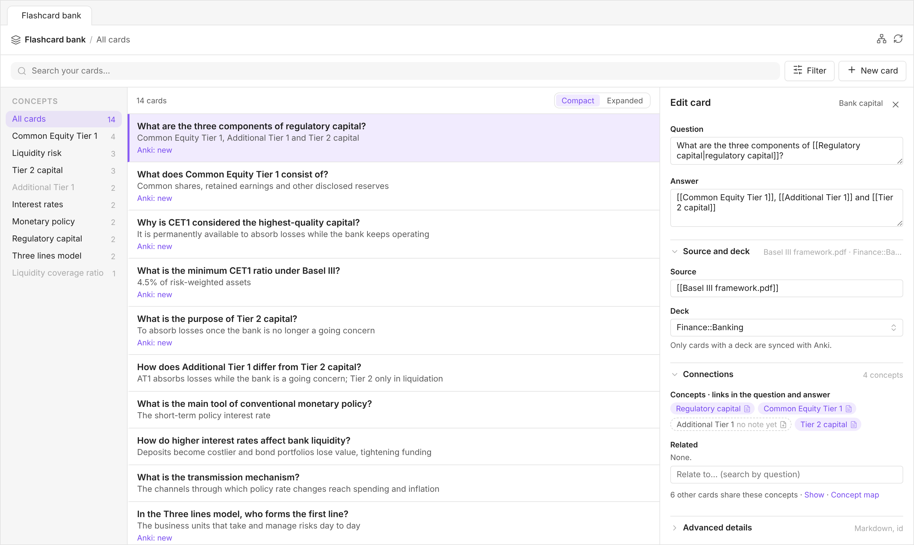
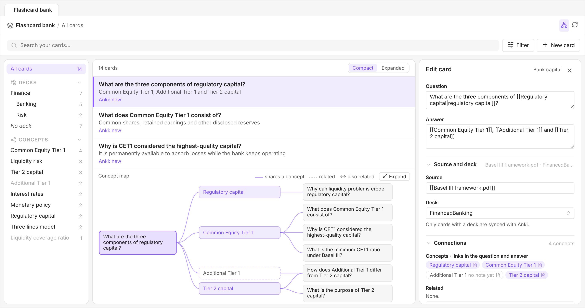
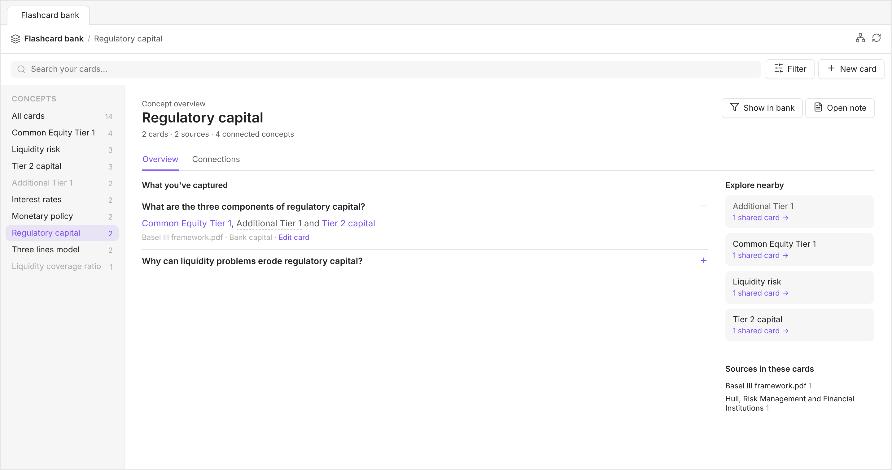
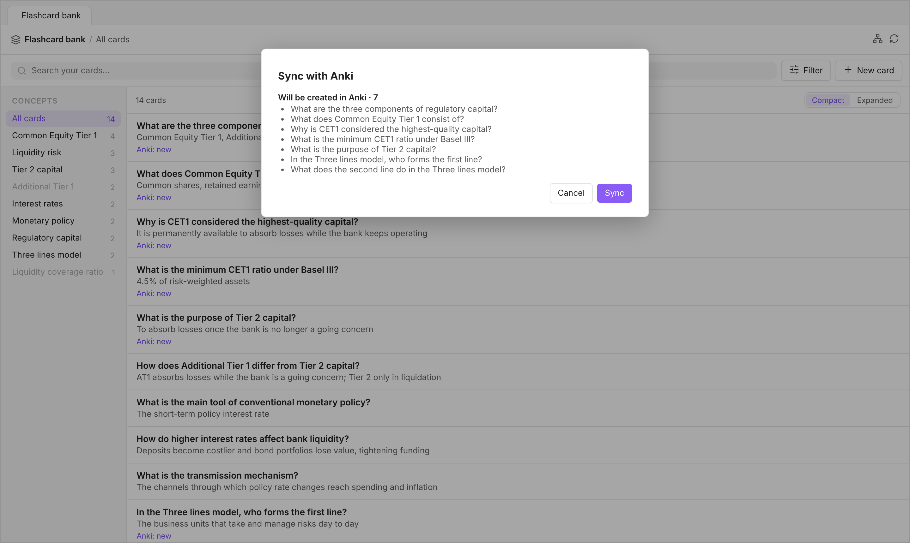

# Flashcard Bank

**Combine Obsidian's knowledge management capabilities with Anki's spaced repetition system.**

Anki is excellent at helping you remember what you've learned. But as your flashcard collection grows, it also becomes something else: a substantial body of knowledge that you might want to explore, organize, connect, and build upon.

Flashcard Bank brings that collection into Obsidian, leveraging its metadata, linking, and visualization capabilities to turn your flashcards into a connected, explorable knowledge base, while sending the cards you choose to Anki for spaced repetition.



## The idea behind Flashcard Bank

### A flashcard collection is a knowledge base

A serious learning practice can produce thousands of flashcards. Together, they represent a substantial investment in understanding and organizing a subject. Yet most flashcard tools are designed primarily around reviewing individual questions and answers, rather than exploring the knowledge contained in the collection as a whole.

Flashcard Bank is built around the idea that your flashcards should be useful beyond spaced repetition. You should be able to search them, organize them, discover connections, and use them as a resource for further learning and thinking.

### Thousands of cards, without thousands of notes

Flashcard Bank takes a different approach to representing cards in Obsidian.

Instead of requiring a separate note for every flashcard, it recognizes cards written as Markdown list items, identified by a tag and a simple question–answer format. Each card can also carry inline metadata, such as its source, related cards, or Anki deck.

This means you can keep multiple cards together in the notes where they belong, while still treating each one as an individual, searchable and filterable item.

And although your cards can live anywhere in your vault, you can manage them all from one central interface. Flashcard Bank automatically gathers cards from across your notes into a unified view, where you can browse, search, filter, create, and edit them without having to open the notes they live in. New cards are added to whichever note you choose.

Your cards remain part of your notes, without turning your vault into an overwhelming collection of tiny files or sacrificing the convenience of a centralized card manager.

### A web of knowledge emerges from your cards

Flashcards don't have to exist as isolated questions and answers.

By including ordinary Obsidian `[[wikilinks]]` in a card's question or answer, you connect it to the concepts it addresses. Cards that refer to the same concepts become connected automatically, even when they live in different notes.

As your collection grows, these connections form an increasingly rich network of knowledge that you can explore through the plugin's concept map. You can move from a concept to the cards that address it, discover relationships between different areas of knowledge, and follow direct links between individual cards.

The network emerges naturally from the way you write your cards. There's no need to maintain a separate graph or manually catalog every relationship.



### Your notes remain the source of truth

Cards are ordinary Markdown content stored in your Obsidian notes. Flashcard Bank doesn't maintain a separate database of them: it reads the cards from your notes and writes edits directly back to their original locations.

This allows you to work with your flashcards as part of your broader personal knowledge base, using Obsidian's linking and organizational capabilities.

### Obsidian for knowledge, Anki for memory

Flashcard Bank doesn't replace Anki. It complements it.

Obsidian provides the environment for creating, connecting, organizing, and exploring your knowledge. Anki provides the spaced repetition system that helps you retain it.

You decide which cards to synchronize, and Obsidian remains the source of truth for their content.

Anki helps you remember your knowledge. Obsidian helps you work with it.

## Installation

From Obsidian: Settings → Community plugins → Browse, search for **Flashcard Bank**, install it, then enable it.

Manually: download `main.js`, `manifest.json` and `styles.css` from the [latest release](../../releases/latest) into `<vault>/.obsidian/plugins/flashcard-bank/`, then enable **Flashcard Bank** in Settings → Community plugins.

It requires Obsidian 1.7.2 or later.

## Network use

The plugin makes no network requests except for the optional Anki sync. When you sync, it talks to the [AnkiConnect](https://ankiweb.net/shared/info/2055492159) add-on running inside Anki on your own computer (by default `http://127.0.0.1:8765`). Nothing is sent anywhere else, and there's no telemetry.

## Getting started

- The **layers** icon in the ribbon (*Open flashcard bank*), or
- Command palette → **Flashcard Bank: Open bank**
- Command palette → **Flashcard Bank: New card** opens the bank with an empty card form.

## What counts as a card

Any list item that carries the card tag (`#flashcard` by default):

```markdown
- What does [[Tier 2 capital]] measure? – Losses once the bank is no longer a going concern [Source:: [[Book.pdf]]] [Related:: ] [Deck:: Finance] #flashcard ^e57187
```

- **Question and answer** are split on the first ` – `, ` — ` or ` - `.
- **Fields** are inline fields (`[Name:: value]`). The three the plugin uses (source, related, deck) have configurable names (see *Field names*). Any other inline field on the line is left untouched.
- **Block id**: the `^id` at the end of the card. A card whose id sits alone on the next line (no blank line in between) is read correctly too.
- **A list marker or checkbox** before the question (`- `, `- [ ] `, `- [?] `…) is kept as is.
- **Indentation** doesn't mean anything: a card indented under another card is read exactly like any other card.
- **Skipped**: folders listed under *Excluded folders*, fenced code blocks, frontmatter, and list items without the tag (`#flashcards` doesn't count).

## How cards connect

| Connection | How you write it | Meaning |
|------------|------------------|---------|
| **Concepts** | `[[links]]` to notes in the question or answer | The card is about that concept. Every card that mentions the same concept is grouped around it, without you having to know which cards exist. |
| **Related** | Block links (`[[Note#^id]]`) in the *Related* field, or in the question or answer | A direct link to one specific card. It's written on one card; the concept map shows it from both sides. |

### Concepts

A concept is a note linked from a card's question or answer. Links in fields (the source, for example) don't count, and neither do embeds (`![[image.png]]`).

- **Matched through Obsidian.** Links are resolved like any other link, so different spellings that lead to the same note (its aliases, a different capitalization, a link to one of its headings) are the same concept.
- **The note doesn't have to exist.** A link to a note you haven't created yet is still a concept, shown dashed, with "no note yet". It's matched by name, ignoring capitalization. Once you create the note, it becomes a normal concept.
- **Specific is better.** A concept mentioned by every card doesn't tell you anything; links work best on precise ideas.

Since they're ordinary links, concepts also work outside the plugin: a concept note's backlinks list every card that mentions it, and the graph view shows the notes your cards live in connected to their concepts.

## The bank

| Area | What it does |
|------|--------------|
| **Header** | Where you are (*All cards*, a concept you're filtering by, or a concept page), plus two buttons: the **concept map** and **Sync with Anki**. |
| **Search bar** | Searches questions, answers and every field. **Filter** opens a source filter (each linked file, plus any plain-text source) and a note filter; the button shows how many are on. **New card** opens an empty card. |
| **Concepts** (left) | Every concept, with how many cards mention it, most-used first. Click one to open its [concept page](#concept-pages). *All cards* shows the whole bank; *No concepts* lists the cards that don't link to any. |
| **List** (middle) | The matching cards, as plain text. **Compact** shows one line of question and one of answer; **Expanded** shows them in full, with the source, deck, note, the number of related cards, and **no id** when the card has no block id. Both show the card's Anki status (*Anki: new*, *Anki: changed*, *Synced with Anki*, *Anki: will be deleted*). The choice is remembered. |
| **Map** | The concept map of the open card, under the list. The card is on the left, its concepts in the middle, and the other cards that mention each concept on the right. A card sharing several concepts is drawn once with a line from each, so the cards that bridge concepts stand out. Related cards get ↔, or a dashed line when they share no concept. Clicking a card centers the map on it; clicking a concept opens its page. The map shrinks to fit the column; **Expand** in its header hides the list so the map gets the whole middle column, and **Back to list** restores it. |
| **Editor** (right) | Opens when you click a card. |

In a narrow pane (or on a phone) the bank shows one panel at a time: opening a card replaces the list with the editor, and **Cards** at its top brings you back to the list where you left it, with the same search, filters and scroll position. In a very narrow pane the concepts become a strip above the list.

The bank uses your theme's colors and accent color, in light and dark mode.

## Concept pages

Clicking a concept opens a page that brings together everything your cards say about it. The editor keeps its state underneath: **Flashcard bank** in the header takes you back.



- **Overview**: the cards that mention the concept (click a question to show its answer, source and note, and **Edit card** to open it in the editor), the concepts that share cards with it under **Explore nearby**, with how many cards they share, and the sources those cards cite. Clicking a source shows the bank filtered by the concept and that source.
- **Connections**: for each concept that shares cards with this one, the cards that link the two. Click a card to read its answer, or the other concept to go to its page.
- **Show in bank** filters the list by the concept; **Open note** opens the concept's note (or **Create note**, if it doesn't exist yet).

## The editor

The editor has the question and answer at the top, and three sections below that you can fold away. Which ones are open is remembered.

- **Question / Answer**: single line each. Enter doesn't add line breaks (Ctrl/Cmd+Enter saves).
- **Source and deck**
  - **Source**: free text, or type part of a file name and pick it to insert `[[file]]`. Separate several sources with commas.
  - **Deck**: the Anki deck. Click the field to pick a deck already in use, or type a new one. Only cards with a deck are synced.
- **Connections**
  - **Concepts**: the concepts linked in the question and answer, updated as you type. Click one to open its concept page; the note icon opens its note (or creates it, if it doesn't exist yet).
  - **Related**: the links in this card's own *Related* field (× removes one). Type in the search box to add a link. Links written on other cards to this one aren't listed here; they show in the concept map.
  - Below them, how many other cards share these concepts: **Show** lists them, grouped by concept, and **Concept map** shows the map.
- **Advanced details**: the exact line that Save will write to the note, the note and line, the card's block id (or the one it will get on save), and its Anki status.
- **Open in note** opens the note at the card's line in a new tab.

### Creating cards

**New card** opens an empty form with two fields that say where the card goes:

- **Note**: defaults to the note of the card you had open, or the last note you added to. Click it to pick another; notes that already have cards are listed first.
- **Section**: **End of note**, or one of the note's headings, indented by level. A card added to a section goes at the end of that heading's own content, right before the next heading of any level. So picking a heading that has subheadings puts the card before the first subheading. The section you last used for each note is selected next time.

The card goes right after the last line of that section (or of the note). If that line belongs to a list, such as other cards, the new card joins the list; otherwise it's set off by a blank line. If the section disappeared from the note before you saved, nothing is written and the plugin asks you to pick another place.

New cards start with the *New card prefix* from the settings, the source and related fields (empty ones as `[Field:: ]`), the deck if you gave one, the card tag, and a fresh block id.

## What the plugin writes, and when

The plugin only writes when you click **Save** (or confirm a sync), and only these things:

1. **The edited card's line, rewritten in place.** Only the parts you changed are replaced; everything else on the line stays byte-for-byte the same, including indentation, other fields, tags, spacing and an id on its own line. A field the card doesn't have yet (for example the deck) is added after its last field, but only if you gave it a value.
2. **A block id**, when the card has none: 6 random lowercase letters and digits, checked against every `^id` already in that note.
3. **A block id on a related card**, when you link to a card that has none (the chip shows `+id`).
4. **New cards**, appended to the end of a note.

The plugin never moves existing lines.

### Conflict protection

When the editor opens a card, it remembers the card's exact text. On save, the plugin finds the card again (by block id, or by line if it has none) and checks that the text is unchanged. If the line was edited in the note in the meantime, **nothing is written**: you get a notice and the editor reloads with the current text.

The bank refreshes on its own when you edit a note directly. An open card without unsaved changes reloads automatically.

### Undo

A save from the bank is a normal file write, so Ctrl/Cmd+Z inside the note doesn't undo it. Fix the card from the bank, or edit the line by hand.

## Anki sync

One-way sync, Obsidian → Anki, through the [AnkiConnect](https://ankiweb.net/shared/info/2055492159) add-on. Obsidian always wins: edits made to these notes inside Anki are overwritten by the next sync.

### Setup

1. In Anki: Tools → Add-ons → Get Add-ons…, code `2055492159`, then restart Anki.
2. In the plugin settings, under **Anki**, click **Connect**. That reads your Anki's note types so you can pick the type and the fields that get the question and the answer. The defaults are `Basic` / `Front` / `Back`; on Anki in another language they're named differently (e.g. `Básico` / `Anverso` / `Reverso`).
3. Anki must be open whenever you sync.

### Which cards sync

Only cards with a **deck**. Writing `[Deck:: Finance::Risk]` on a card, or filling the Deck field in the editor, is what opts it in. Use Anki's `::` for subdecks. Missing decks are created.

Each card shows its state in the bank:

| Status | Meaning |
|------|---------|
| `Anki: new` | Has a deck, not in Anki yet |
| `Synced with Anki` | In Anki and up to date |
| `Anki: changed` | Question, answer or deck changed since the last sync |
| `Anki: will be deleted` | Was synced, but its deck was cleared; the next sync deletes it from Anki |

### Syncing

Click **Sync with Anki** (the circular arrows at the top of the bank), or run **Flashcard Bank: Sync with Anki**. The plugin reads Anki and shows a summary before changing anything:



- **Will be created**: new cards. Cards with a deck but no block id get one written into their note first, since the pairing needs it.
- **Will be updated**: content changed, deck changed (the note is moved to the new deck), or the card moved to another note. A card that keeps its block id and content when moved stays paired with the same Anki note and keeps its history.
- **Will be re-created**: synced cards whose Anki note was deleted by hand.
- **Will be deleted from Anki**: cards whose deck was cleared, or that were deleted from Obsidian. This also deletes their review history in Anki, so the button then reads **Sync and delete N**. Nothing outside this list is ever deleted.

Cancel and nothing happens. If everything is already in sync, you just get a notice.

### What goes into Anki

- **Front:** the question. **Back:** the answer.
- **Text:** plain text, HTML-escaped. Wikilinks become their alias, or the note name if they have no alias.
- **Tags:** each note gets the plugin's tag (default `flashcard-bank`), and no other tags.

### Ringfencing

The plugin only updates or deletes an Anki note when **both** of these are true:

- It's in the plugin's own register of notes it created. That register is stored in the plugin's `data.json` as `ankiMap`: card `note.md#^id` → Anki note id.
- It still carries the plugin's tag in Anki.

Everything else is never edited or deleted. That includes notes you made by hand, and notes from which you removed the tag; the latter are listed as *left untouched*. Notes that carry the tag but aren't in the register (for example after reinstalling the plugin) are only reported.

## Settings

| Setting | Default | Meaning |
|---------|---------|---------|
| Card tag | `#flashcard` | The tag that marks a list item as a card |
| Excluded folders | *(none)* | One folder per line; cards inside are ignored (e.g. your templates folder) |
| New card prefix | `- ` | Text before the question on new cards (e.g. `- [?] ` for a custom checkbox) |
| **Field names** | | |
| Source | `Source` | Field for where the card comes from |
| Related | `Related` | Field for direct links to other cards |
| Deck | `Deck` | Field for the Anki deck (cards without it don't sync) |
| **Anki** | | |
| Connection address | `http://127.0.0.1:8765` | Where AnkiConnect listens |
| Note type, fields | `Basic`, `Front`, `Back` | Note type and the fields for question and answer. **Connect** lists the real ones |
| Anki tag | `flashcard-bank` | The ringfence tag. Changing it leaves notes with the old tag protected (untouched) |

Field names let the plugin work with cards you've already written in any language, such as `[Fuente:: …] [Conexiones:: …]`. Changing a field name doesn't rename anything in your notes. It only tells the plugin which field to read and write.

## Troubleshooting

If something goes wrong while the bank is open, the error is shown inside the tab and appended to `error.log` in the plugin folder, with the time and the full stack trace.

## How it works

| File | Role |
|------|------|
| `src/card.ts` | Pure card logic, with no Obsidian imports: finding cards in a note, splitting a line into question/answer/fields/tags/id, links in the text, rewriting only changed parts, ids, conflict-checked replacement, appending. |
| `src/store.ts` | The index of all cards (rebuilt on load, then per note when Obsidian reports a change). Also: concepts (a cached index of concept → cards, rebuilt after any change and when notes are created, renamed or deleted), related cards in both directions (with a cached reverse index), and save/create, which use `vault.process` so each write is atomic. |
| `src/view.ts` | The bank tab: concepts list, card list, editor. |
| `src/map.ts` | The concept map (SVG). |
| `src/sync.ts` | Anki sync logic, with no Obsidian imports: `planSync` works out what a sync would do from the cards, the register and Anki's state; `runSync` applies it, updating the register step by step. |
| `src/anki.ts` | AnkiConnect client, using Obsidian's `requestUrl` (no CORS setup needed). |
| `src/ankiui.ts` | The sync flow: checks, summary modal, id assignment, apply, result notice. |
| `src/suggest.ts` | The suggestion dropdown used by the editor inputs. |
| `src/main.ts` | Plugin entry: view, ribbon icon, commands, settings tab, change listeners. |

The index only reads notes whose metadata cache contains the card tag, so large vaults stay fast.

## Development

Requires Node.js 20 or later.

```bash
npm install
npm run dev         # rebuild main.js on every change
npm run build       # typecheck, then a production build of main.js
npm run lint        # ESLint with Obsidian's plugin rules
npm test            # unit tests (tests/card.test.ts and tests/sync.test.ts, against an in-memory fake AnkiConnect)
npm test -- path/to/note.md   # also checks that every card in that note round-trips unchanged
```

Run `npm test` with a few of your own notes after changing the parser: every card in them must come back identical when rewritten without changes.

To release, bump the version (`npm version patch`, or `minor` / `major`) and push, then publish a release whose tag is the new version, either with `git push --follow-tags` or from the repository's Releases page. The release workflow builds the plugin and attaches `main.js`, `manifest.json` and `styles.css` to that release (or creates a draft release with them, if none exists yet). Include the version in the release name.

## About the development

I built Flashcard Bank with Claude Code, working through a careful, iterative process of discussion, implementation, testing, and refinement.

The ideas and vision behind the plugin are my own. Claude Code was instrumental in turning them into working software, but the project has been guided throughout by my own experience, needs, and decisions.

### Support

If you find this plugin useful or the ideas behind it interesting, [consider buying me a coffee](https://ko-fi.com/jcesguerram). I'd really appreciate it!

## License

[MIT](LICENSE) © 2026 Juan Carlos Esguerra
